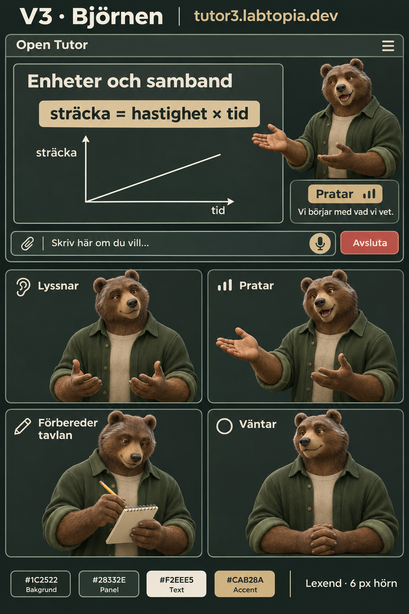
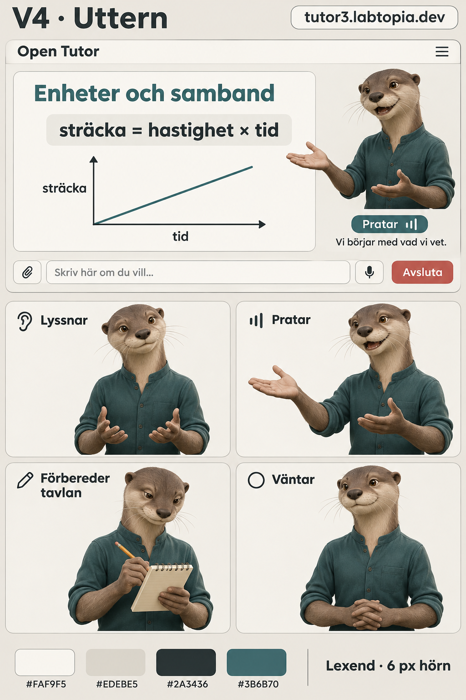
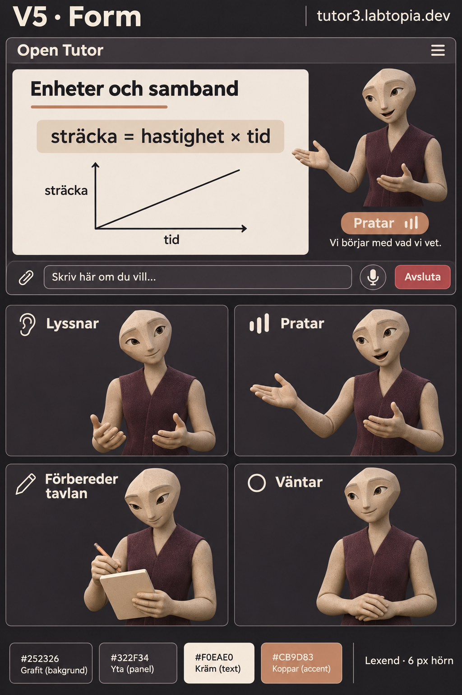
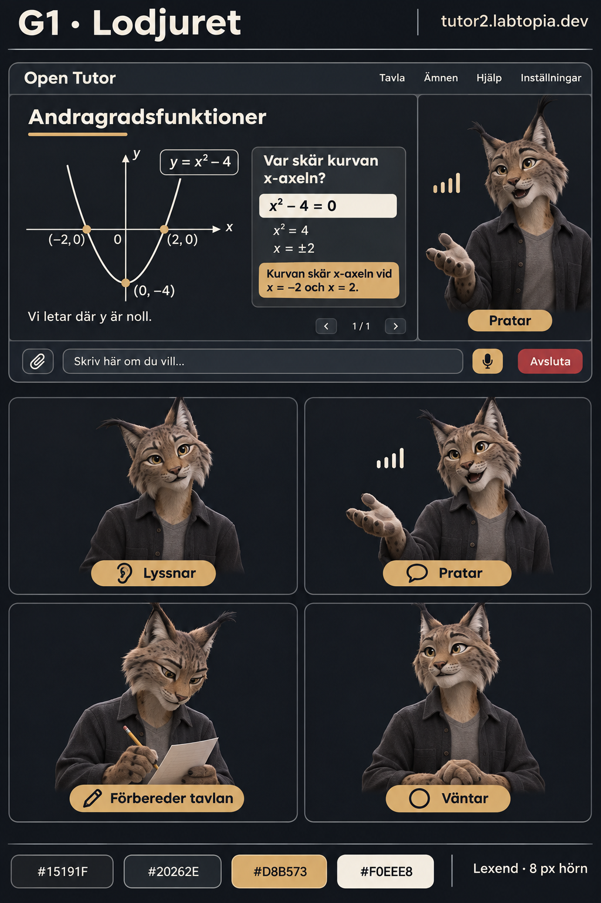
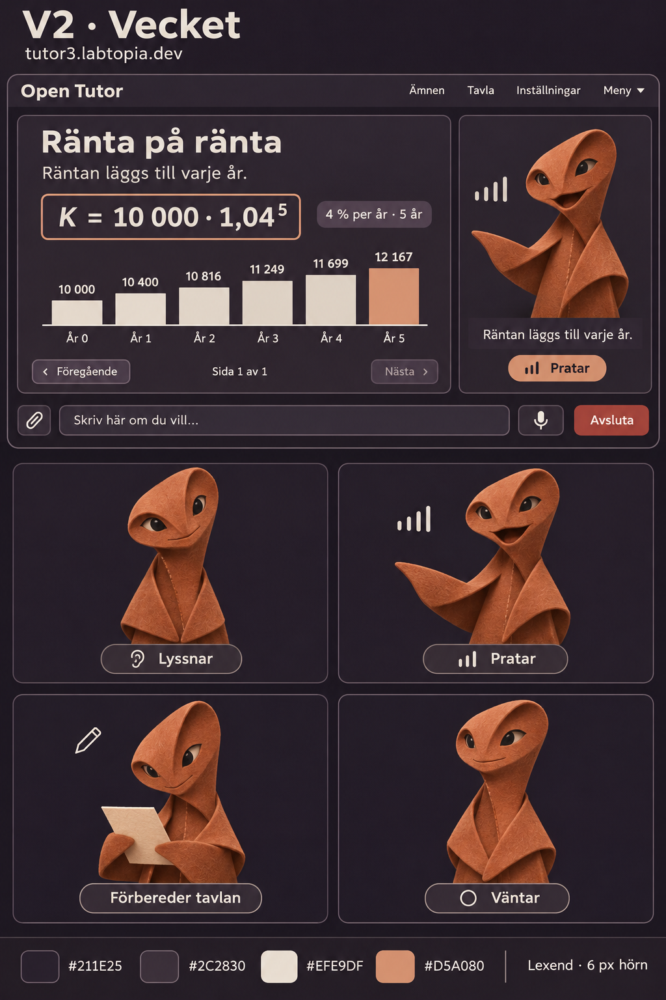

# Age-band design

Owner decision, 2026-11-18: the address selects a band's companion, visual theme, and copy for the entire visit. The voice stays the same.

| Address | Audience | Design status |
| --- | --- | --- |
| `tutor.labtopia.dev` | Åk 1–6 | Keep the current blue fox and screen style |
| `tutor2.labtopia.dev` | Åk 7–9, högstadiet, ages 13–15 | G1 Lodjuret selected by Johan |
| `tutor3.labtopia.dev` | Åk 10+, gymnasiet and adults together | V3 Björnen selected by Johan |

These ranges are Johan's corrected decision of 2026-11-18. They supersede the audience labels in the first-pass prompts and historical directory names. `gymnasiet/concepts/` holds the original tutor2 exploration; `adults/concepts/` holds tutor3. Keep those image paths stable for links already shared in the design thread. Use the corrected address-to-range mapping when producing final assets and configuration.

## Owner feedback, 2026-11-18

G1 Lodjuret is locked as the tutor2 companion for åk 7–9. Preserve its identity and its two articulated hands for explanatory gestures. Keep elbows, palms, and fingers visible within the exported frame. The graphite and amber screen remains the paired proposal. Judge its scale, gestures, and screen style for 13–15-year-olds.

Johan selected V3 Björnen as the tutor3 companion. Hägern and Vecket did not settle that choice. The next pass explores companions with two articulated arms and expressive hands. It was queued immediately before the range correction with adult-focused prompts. Assess the results for gymnasiet students and adults together. The general teaching material and colleague-like companions do not need an age-specific role. See [the second-pass prompts](exploration-2026-11-18/adults-round-2-prompts.json).

## Tutor3 exploration history

These concepts explore teaching gestures for the shared gymnasiet and adult band. All three show two articulated arms and hands, an open-palm explanation, pencil work, and relaxed folded hands. The four states remain listening, speaking, preparing the board, and waiting.

| ID | Companion | Screen proposal |
| --- | --- | --- |
| V3 | Björnen. Broad shoulders, mature bear face, rolled sleeves | Deep forest-grey, linen, and brass |
| V4 | Uttern. Slender otter with a long muzzle and rolled sleeves | Light warm grey, charcoal, and petrol |
| V5 | Form. A fictional limestone figure with articulated hands | Warm graphite, cream board, and terracotta |

All three propose Lexend and flat cards with 6 px corners. These are generated still-image proposals, not final assets or implemented theme tokens.

## First concept pass

Generated with the built-in image generation tool. All characters and lesson material are fictional. Direction names describe the concepts; they are not selected product names. Exact prompts are in [prompts.json](exploration-2026-11-18/prompts.json).

Each sheet pairs an in-call screen with four larger character states: listening, speaking, preparing the board, and quietly waiting. The state label and icon supplement posture and expression. Speech bars belong only to speech.

| ID | Companion | Screen proposal |
| --- | --- | --- |
| G1 | Lodjuret. A grey lynx in a plain overshirt | Graphite and amber, Lexend, thin borders, 8 px card corners |
| G2 | Korpen. A sculpted dark corvid | Ink and lilac, Lexend, thin borders, 10 px card corners |
| V1 | Hägern. A limestone ceramic heron | Light mineral and forest green, Lexend body with serif titles, 4 px card corners |
| V2 | Vecket. An abstract folded terracotta companion | Dark aubergine and linen, Lexend, thin borders, 6 px card corners |

The generated text and typography are illustrative. The documented font and colour proposals will become actual theme tokens only after selection. Characters and palettes can be mixed between directions.

Generated navigation labels and lesson text are not interface or curriculum specifications. Keep the current menu and call controls when implementing the selected look.

### Tutor2, åk 7–9

### Tutor3, gymnasiet and adults

## Current asset contract

Inspected on `origin/main` at `a2685c1`, 2026-11-18, and rechecked unchanged against `9063c47` after the age-range correction. `web/src/components/Avatar.tsx` renders a transparent static WebP at `/character/<pose>.webp`. There are no video loops or sprite animations. Status icons and speaking motion are separate UI elements.

| Pose | Current dimensions |
| --- | --- |
| `greeting` | 544 × 638 |
| `listening` | 386 × 565 |
| `speaking` | 408 × 570 |
| `thinking` | 413 × 563 |
| `working` | 661 × 900 |
| `waiting` | 397 × 585 |
| `pointing` | 432 × 539 |

Selected companions need all seven poses, transparent alpha, full ears or head and gestures inside the crop, and consistent face placement for the phone's circular crop. The four-state concepts group `thinking` and `working` as preparation, and `speaking` and `pointing` as speech. Final exports must preserve those separate runtime states.

Gesture verification must check the displayed body crop as well as the source image. The current circular phone head crop cannot show hands. Review the teaching layout before claiming that exported gestures are visible on phones.

The screen shell uses Lexend and its own CSS variables in `screen/shell/shell.css`. The outer app has a separate `--ot-*` variable set in `web/src/styles.css`. A selected theme must cover both, including teaching colours, muted text, answer controls, and focus states.

## Delivery and landing-page choice

The companion choices are settled: Lodjuret for middle and Björnen for upper. Final art sources, PNG exports, and shared theme tokens live in `middle/` and `upper/`. The app consumes all seven WebP poses under `web/public/character/<band>/`. Rebuild with `python3 scripts/export_band_companions.py`; the export manifest records source strips and pose order. PNG and WebP outputs preserve alpha, use at most 900 px height, and WebP quality 88. The fox files remain unchanged.

The exact final-art prompts are in [production-pair-prompts.json](production-pair-prompts.json). The initial seven-pose atlas was superseded because its rendering crowded the ear tips. The exporter finds the actual transparent gutter between the two figures rather than assuming an exact 50/50 layout.

The app's `BandProvider` supplies a stable per-band config to the arrival image, every call pose, the phone companion, and each teaching frame. The new bands' fixed spoken greeting and tutor self-introduction use their selected companion name; the primary greeting and instructions remain byte-identical to the host-selection base. TTS voice configuration is unchanged. `theme.css` is the single token source for both web and shell names. Vite bundles it as text; the server's preview renderer reads that same file from the learner's band. Primary uses its original style declarations.

Johan requested [landing alternatives A/B/C](landing-exploration/README.md) while the companion exports were underway. On 2026-11-19 he chose B's welcome bubble with C's single start button and no pre-call name field. The tutor learns the name by voice in the call, with typed recovery when needed. The refined mock images and implementation handoff are in that record. This flow is selected but not implemented yet. No merge, deploy, or live-service restart is authorised.

These concept images do not verify readability in the running app, state transitions, motion, or voice synchronisation. No live lesson or service is changed by this pass.

## Host-selection integration contract

This integration includes the reviewed PR #78 host-selection implementation now merged into main at `f0c6d64`. It retains that implementation's host resolver, name-only onboarding and learner tools. The design PR targets main; the selected B+C flow is a separate pending implementation.

- `web/src/bands.ts` owns `companion.asset`, `companion.name`, the complete `companion.poses` map, and `theme.stylesheet`.
- `web/src/BandContext.tsx` exposes that config without resolving the host again in child components.
- `design/bands/middle/theme.css` and `upper/theme.css` supply the existing `--ot-*` and shell variable names. New-band layout styling lives in `web/src/bandStyles.css`.
- `screen/tools/screenkit.py` composes the matching preview theme. `server/open_tutor/screen.py` passes the learner band.
- `web/band-review.html?band=middle|upper|primary` is a development-only review entry using the actual avatar, controls and teaching-frame components, with fictional content and no voice-provider call.
