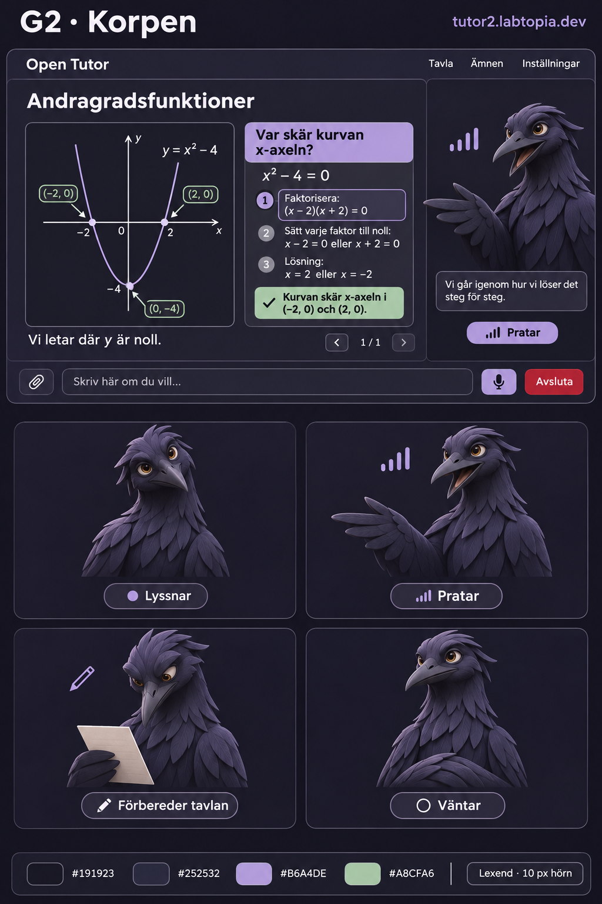
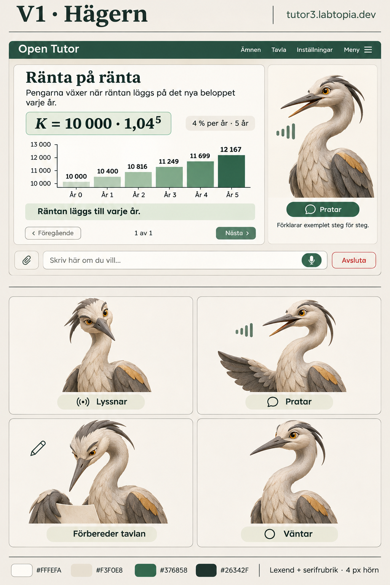

# Age-band design

Owner decision, 2026-11-18: the address selects a band's companion, visual theme, and copy for the entire visit. The voice stays the same.

| Address | Audience | Design status |
| --- | --- | --- |
| `tutor.labtopia.dev` | Middle school | Keep the current blue fox and screen style |
| `tutor2.labtopia.dev` | Gymnasiet | Two concepts awaiting Johan's choice |
| `tutor3.labtopia.dev` | Adults | Two concepts awaiting Johan's choice |

## First concept pass

Generated with the built-in image generation tool. All characters and lesson material are fictional. Direction names describe the concepts; they are not selected product names. Exact prompts are in [prompts.json](exploration-2026-11-18/prompts.json).

Each sheet pairs an in-call screen with four larger character states: listening, speaking, preparing the board, and quietly waiting. The state label and icon supplement posture and expression. Speech bars belong only to speech.

| ID | Companion | Screen proposal |
| --- | --- | --- |
| G1 | Lodjuret. A grey lynx in a plain overshirt | Graphite and amber, Lexend, thin borders, 8 px card corners |
| G2 | Korpen. A sculpted dark corvid | Ink and lilac, Lexend, thin borders, 10 px card corners |
| V1 | Hägern. A limestone ceramic heron | Light mineral and forest green, Lexend body with serif titles, 4 px card corners |
| V2 | Vecket. An abstract folded terracotta companion | Dark aubergine and linen, Lexend, thin borders, 6 px card corners |

The generated text and typography are illustrative. The documented font and colour proposals will become actual theme tokens only after selection. Characters and palettes can be mixed between directions.

Generated navigation labels and lesson text are not interface or curriculum specifications. Keep the current menu and call controls when implementing the selected look.

### Gymnasiet

### Adults

## Current asset contract

Inspected on `origin/main` at `a2685c1`, 2026-11-18. `web/src/components/Avatar.tsx` renders a transparent static WebP at `/character/<pose>.webp`. There are no video loops or sprite animations. Status icons and speaking motion are separate UI elements.

| Pose | Current dimensions |
| --- | --- |
| `greeting` | 544 × 638 |
| `listening` | 386 × 565 |
| `speaking` | 408 × 570 |
| `thinking` | 413 × 563 |
| `working` | 661 × 900 |
| `waiting` | 397 × 585 |
| `pointing` | 432 × 539 |

Selected companions need all seven poses, transparent alpha, full ears or head and gestures inside the crop, and consistent face placement for the phone's circular crop. The four-state concepts group `thinking` and `working` as preparation, and `speaking` and `pointing` as speech. Final exports must preserve those separate runtime states.

The screen shell uses Lexend and its own CSS variables in `screen/shell/shell.css`. The outer app has a separate `--ot-*` variable set in `web/src/styles.css`. A selected theme must cover both, including teaching colours, muted text, answer controls, and focus states.

## Next delivery gates

1. Johan chooses or revises one companion and screen direction per new band.
2. Produce final assets and per-band tokens. Fetch main and inspect open PRs again before agreeing asset paths with the host-selection worker. Open a PR when this step is ready. Do not merge, deploy, or restart services.
3. After the asset and theme choice, show name-only arrival mockups for all three bands. Use "Vad heter du?" and a start action. Put "Byt elev" in the menu.

These concept images do not verify readability in the running app, state transitions, motion, or voice synchronisation. No live lesson or service is changed by this pass.
