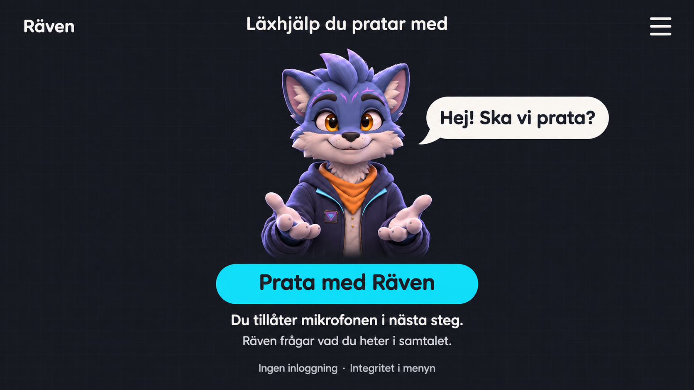
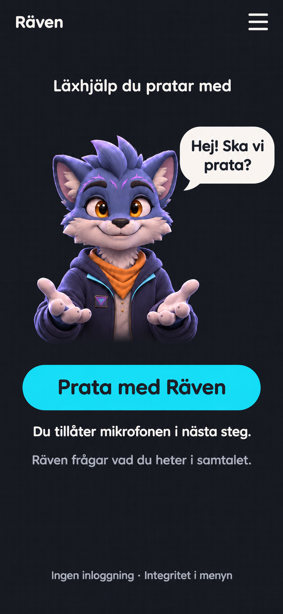
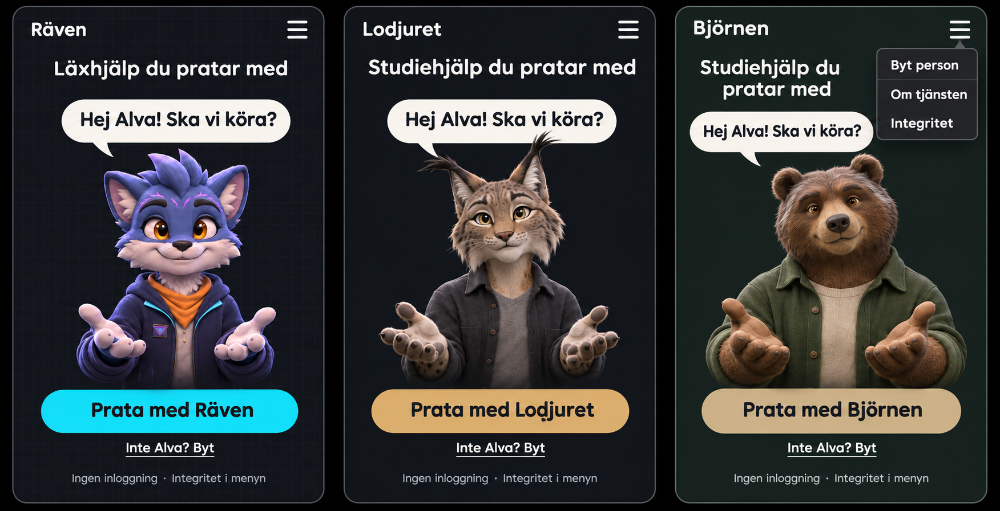
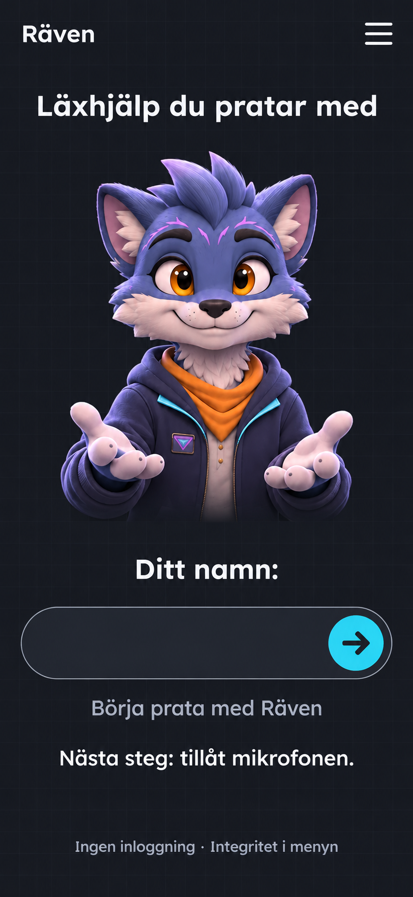
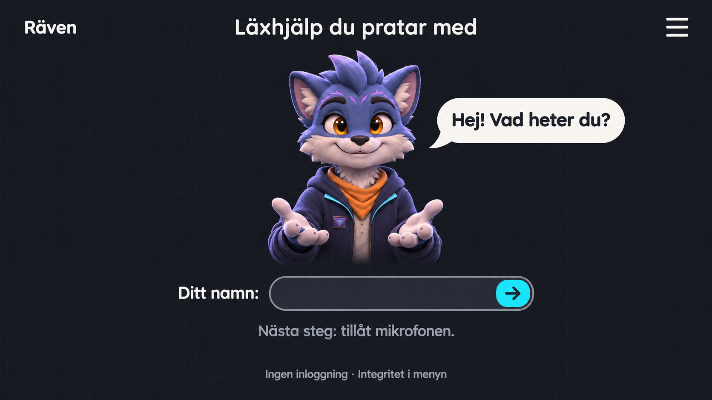
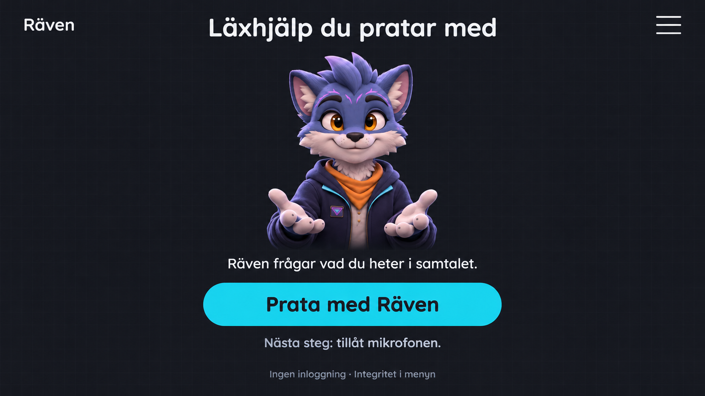
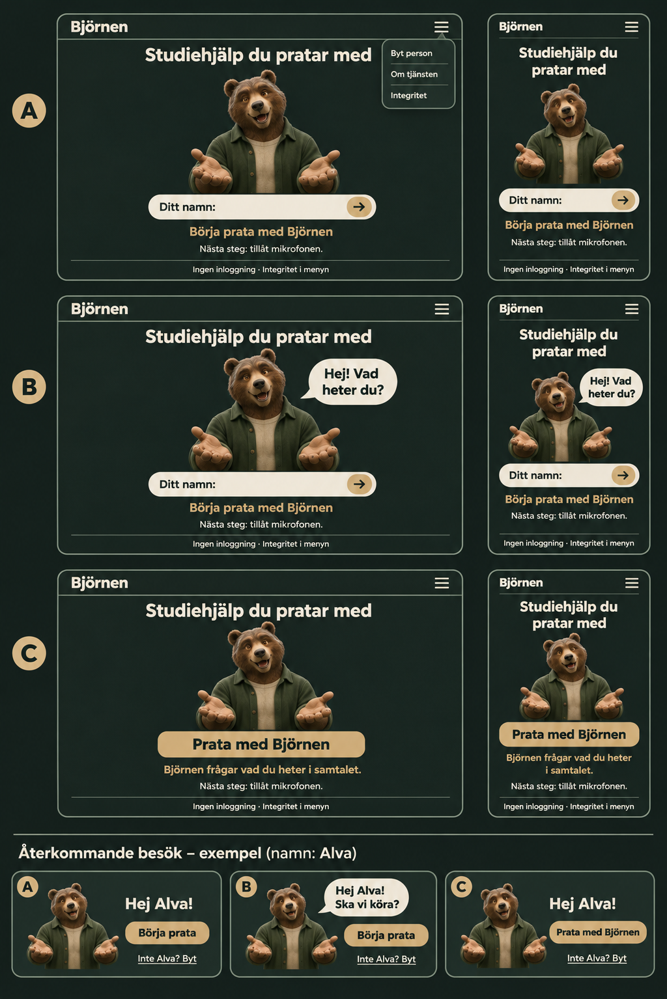

# Landing-page alternatives

Generated with the built-in image generation tool on 2026-11-18 from Johan's [sketch](owner-sketch.png). Johan selected a B+C combination on 2026-11-19. No B+C onboarding behaviour has been implemented yet. [Exploration prompts](prompts.json).

## Selected direction: B's bubble and C's start button

Johan's choice combines the companion's welcome bubble with a single action that starts the conversation. There is no name field before the call. The tutor asks for the name by voice after the learner starts and grants microphone access.

The proposed first-visit bubble is "Hej! Ska vi prata?", with "Prata med Räven" as the start action. This avoids asking a question that the learner cannot answer while the microphone is still off. The same pattern uses "Prata med Lodjuret" and "Prata med Björnen" on the other bands.

A returning learner sees "Hej Alva! Ska vi köra?", the same start button, and a small "Inte Alva? Byt" link. Alva is fictional. The menu stays at top right, with "Byt elev" or "Byt person", "Om tjänsten", and "Integritet".

These refinements are mock images, generated using the [selected-direction prompts](selected-bc-prompts.json). They replace the separate B and C proposals below.

### Implementation handoff

- Start without inventing or preselecting a name for a new learner. Microphone permission follows the start action.
- Ask for the name naturally in the call, then associate the session with the existing local profile or create one. A returning profile can start directly.
- Keep a typed-name recovery path inside the call when speech recognition fails, including the existing text route if the microphone is unavailable.
- Switching the assumed learner must return to the nameless start flow, without a pre-call name field or profile grid.
- The static welcome bubble is not audio playback. Do not animate speaking indicators before the call starts.
- Check the real first-visit, returning-visit, wrong-person, blocked-microphone, and misheard-name paths before claiming that voice-first onboarding works.

The current implementation from PR #78 still asks for a name before starting. The selected flow needs coordinated frontend and tutor identity handling; this design update does not claim that behaviour is shipped.

All directions keep the companion centred, the brand at top left, and the menu at top right. The first visit explains the purpose, the next microphone step, and where to read about privacy. The primary band keeps its dark slate, blue fox, and cyan accent. The two other bands use their selected companions and palettes as quick reskins.

## A. Refined sketch

The name field makes the first step explicit and gives the tutor a reliable name before the call. An integrated arrow keeps the page compact. Typing remains a barrier for younger children, and the arrow needs an accessible label that says it starts the conversation.

## B. Conversational

The companion's question explains why the field is there. The same bubble can greet a returning learner without another form. A visual speech bubble can imply that audio has already started, so the pre-call character stays silent and the start action must remain clear.

## C. Voice first

One action gets the learner into the conversation without typing. It directly introduces the voice experience. Names are difficult speech-recognition input: the call needs spoken confirmation and a text fallback, and a shared device still needs a clear way to switch learner.

## Returning visits and menu

The fictional returning learner is Alva. A and B replace the form with a greeting and one start button. C uses the name learned in the earlier voice call. Every direction has a small "Inte Alva? Byt" link. The menu opens below the top-right hamburger and contains "Byt elev", "Om tjänsten", and "Integritet". The upper band uses "Byt person".

## The same directions across bands

These are quick portability checks, not replacement production character assets. Generated decoration and wording are illustrative. Final UI must keep the field label outside the input, avoid decorative title underlines, and use a closed-mouth pre-call pose.

## Recommendation

The initial recommendation was B with typed entry. Johan chose B's visual welcome with C's voice-first entry instead. Preserve the single-button arrival and prove the in-call name and recovery paths during implementation.
