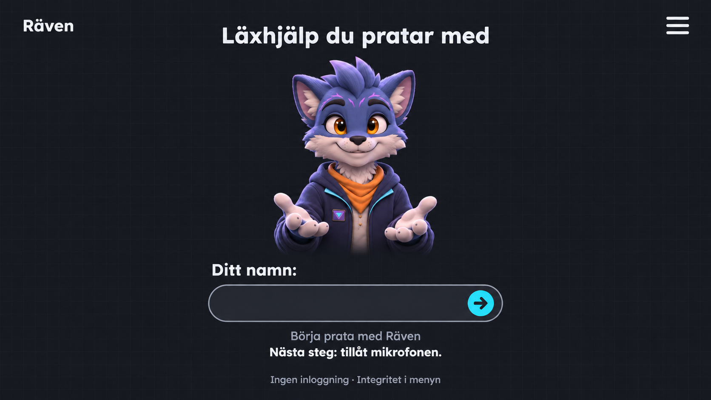
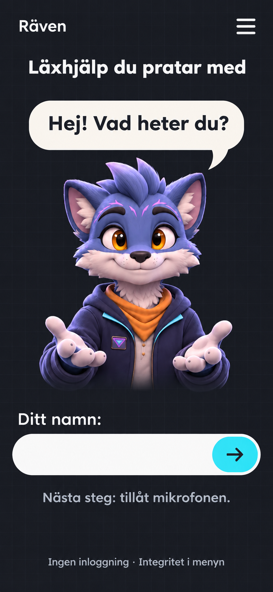
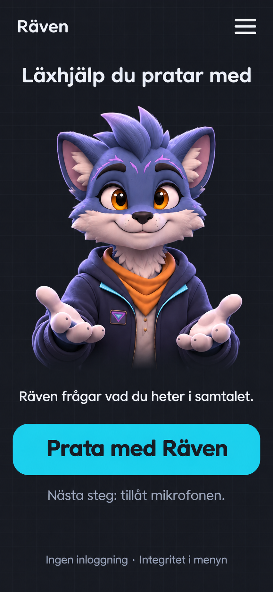
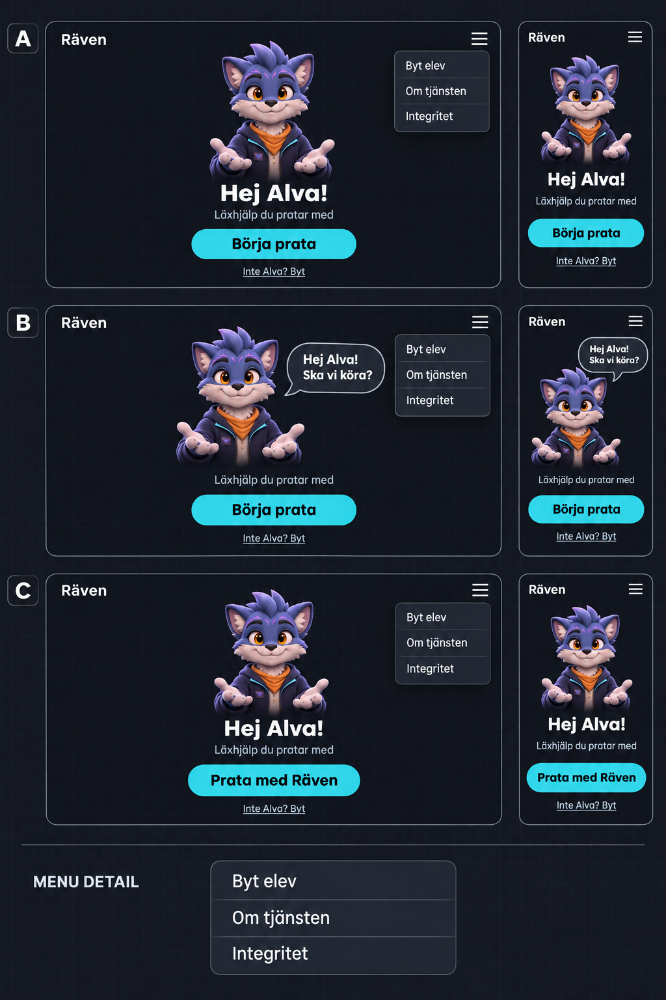
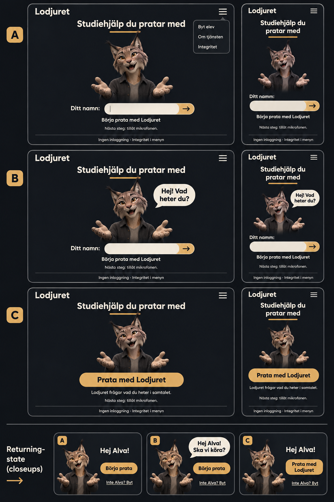

# Landing-page alternatives

Generated with the built-in image generation tool on 2026-11-18 from Johan's [sketch](owner-sketch.png). These are proposals awaiting his choice. No A/B/C onboarding behaviour has been implemented. [Exact prompts](prompts.json).

All directions keep the companion centred, the brand at top left, and the menu at top right. The first visit explains the purpose, the next microphone step, and where to read about privacy. The primary band keeps its dark slate, blue fox, and cyan accent. The two other bands use their selected companions and palettes as quick reskins.

## A. Refined sketch

The name field makes the first step explicit and gives the tutor a reliable name before the call. An integrated arrow keeps the page compact. Typing remains a barrier for younger children, and the arrow needs an accessible label that says it starts the conversation.

## B. Conversational

The companion's question explains why the field is there. The same bubble can greet a returning learner without another form. A visual speech bubble can imply that audio has already started, so the pre-call character stays silent and the start action must remain clear.

## C. Voice first

One action gets the learner into the conversation without typing. It directly introduces the voice experience. Names are difficult speech-recognition input: the call needs spoken confirmation and a text fallback, and a shared device still needs a clear way to switch learner.

## Returning visits and menu

The fictional returning learner is Alva. A and B replace the form with a greeting and one start button. C uses the name learned in the earlier voice call. Every direction has a small "Inte Alva? Byt" link. The menu opens below the top-right hamburger and contains "Byt elev", "Om tjänsten", and "Integritet". The upper band uses "Byt person".

## The same directions across bands

These are quick portability checks, not replacement production character assets. Generated decoration and wording are illustrative. Final UI must keep the field label outside the input, avoid decorative title underlines, and use a closed-mouth pre-call pose.

## Recommendation

Start with B if the first release should establish the learner before the call. It makes the purpose of the field part of meeting the companion. Keep C as a separate interaction choice: it needs a real name-recognition and recovery check before replacing typed entry.
