# Open Tutor mockups: second pass

Rendered PNG concepts, generated with the built-in imagegen tool. These are images, not implemented screens. [PRD](../../../PRD.md) · [Style guide](../../STYLE-GUIDE.md) · [Exact generation prompts](prompts.json).

This pass keeps the blue companion, removes its wings, and turns its gaze toward the learner or inward toward the board. It also reduces decorative framing, gives teaching more space, and removes speaking waveforms from silent states. Fictional learners and resources remain illustrative.

The selected set contains ten screens and one character sheet. Files ending in `-plain.png` are the corrected versions of three renders that initially added an unwanted room background. The earlier renders remain separate. Layout and type details are design proposals; implementation will make them consistent across states.

## Revised character

The same blue companion, without wings, in listening, speaking, thinking and waiting poses.

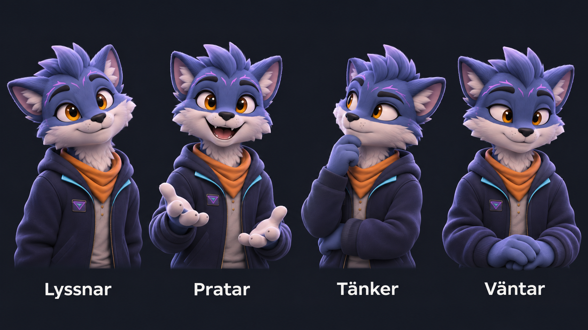

## Choose a learner

Frontal greeting pose; no active learner or call controls before starting.

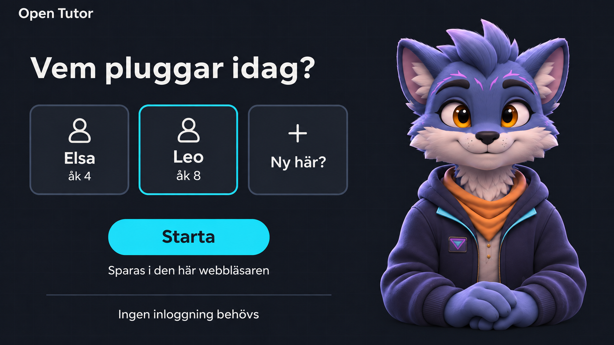

## Meet the tutor

Direct eye contact, large welcoming character and simpler page styling.

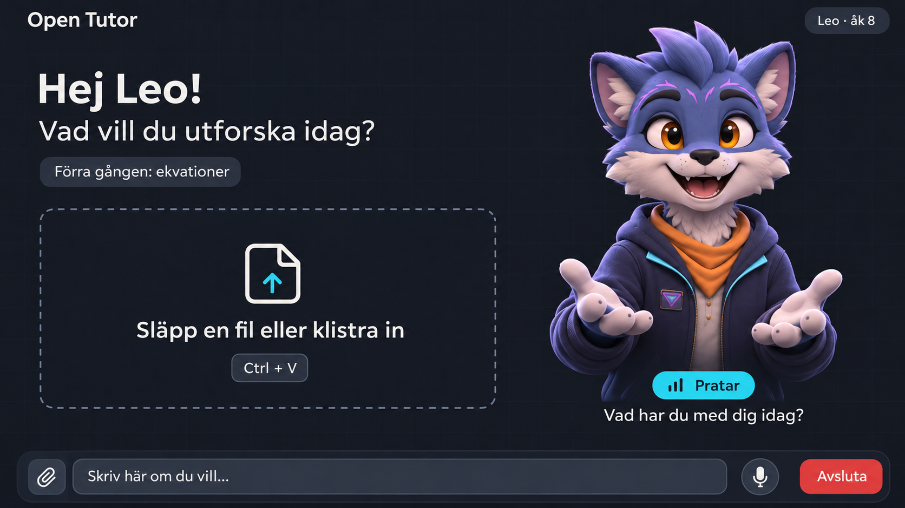

## Bring in homework

A readable worksheet and an inward-facing companion.

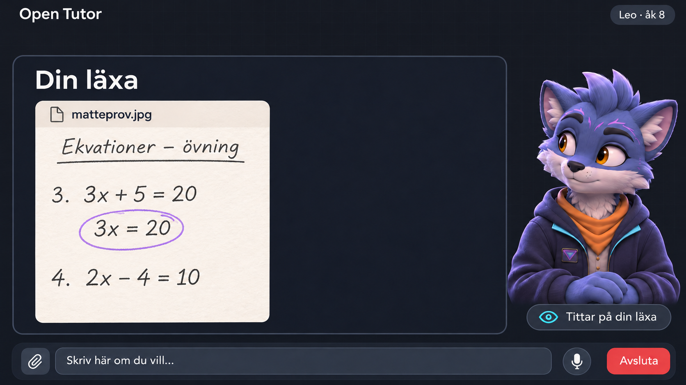

## Explain visually

More room for the original problem and worked steps. The companion faces the board.

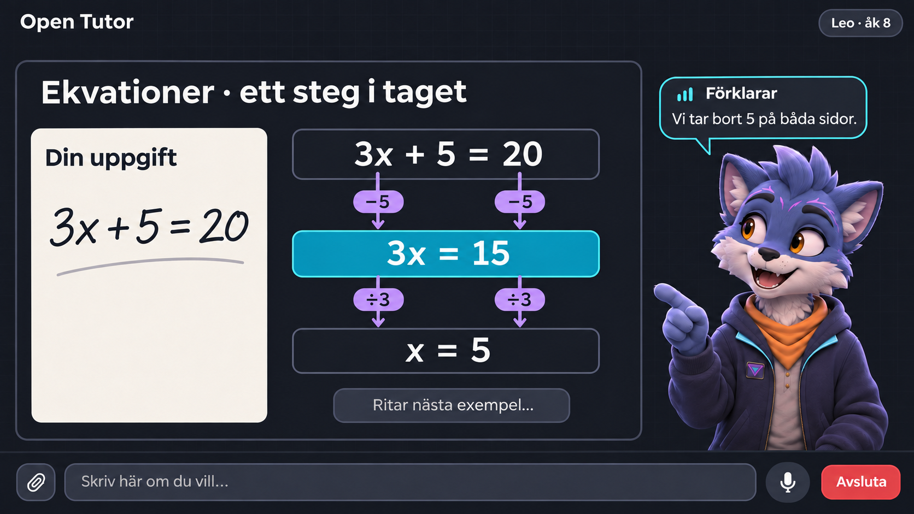

## Coach a book review

The learner's ideas and pasted draft; the character listens without a speaking waveform.

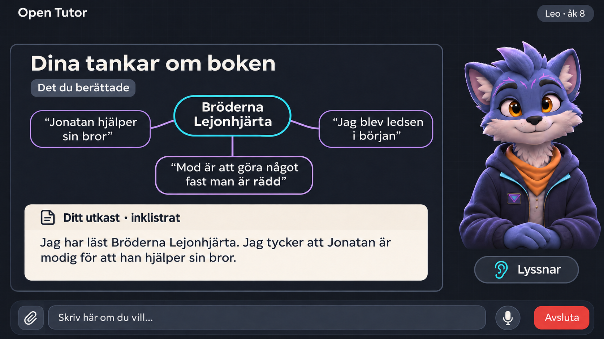

## Allow quiet work

An unfinished task with patient, inward-looking presence.

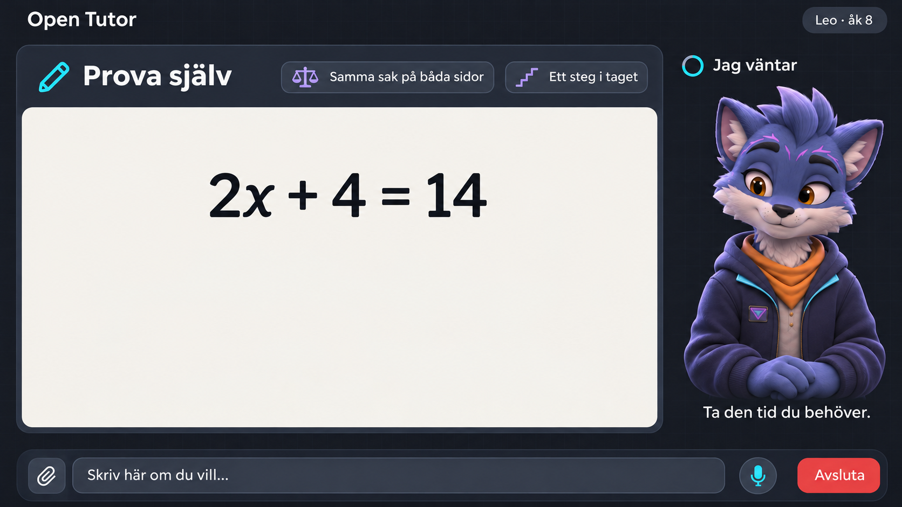

## Watch a resource

A fictional chemistry video, with the companion facing the central content.

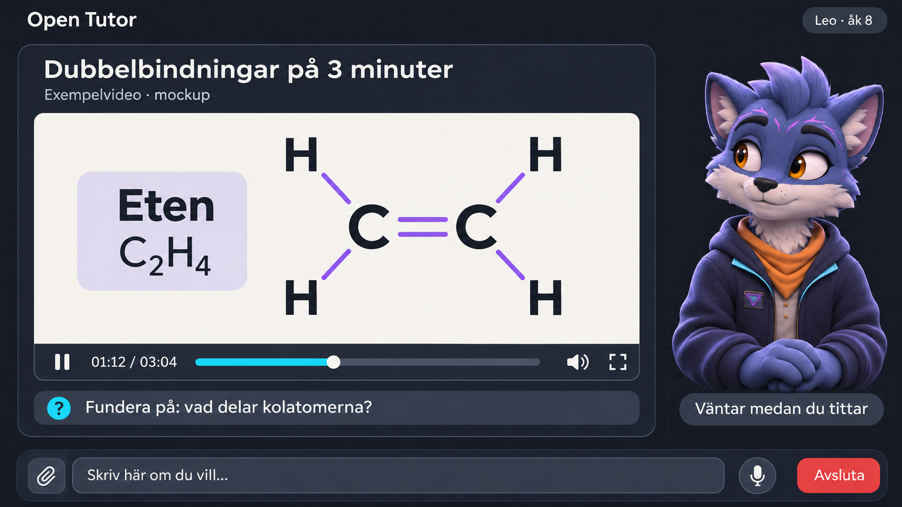

## Recognise understanding

Direct acknowledgement of the learner's answer.

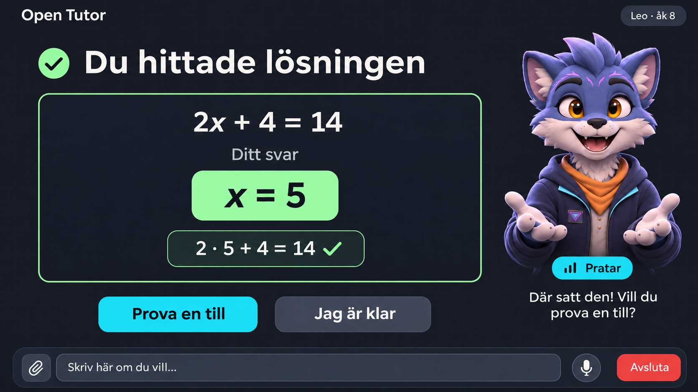

## End and remember

Short notes saved in the browser and a frontal farewell pose.

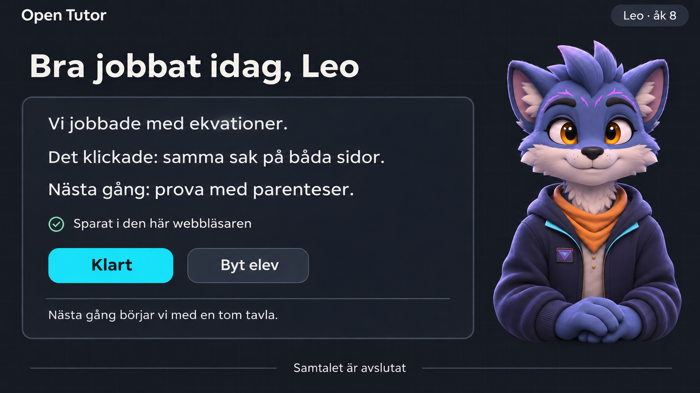

## Recover from blocked microphone

Text remains available; no false speaking indicators.

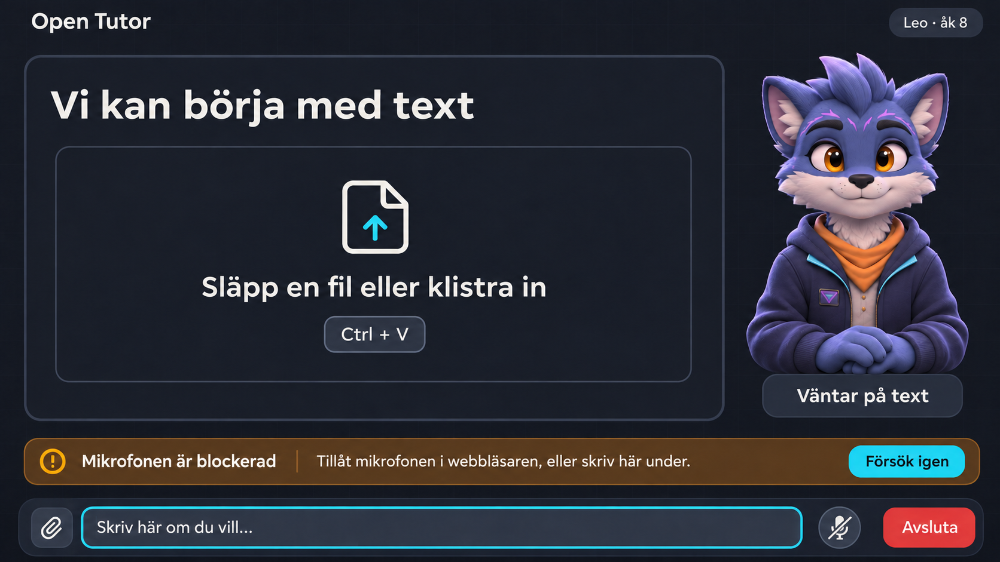
